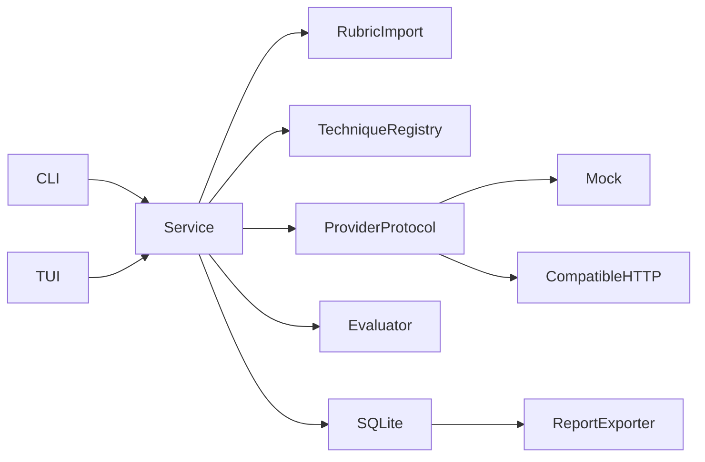

# Faultline architecture

Status: Phase 1 foundation. Python 3.12+, local SQLite, Textual interface.

## Boundaries and decisions

`domain.py` owns strict, versioned Pydantic schemas. `rubrics.py` imports and
validates documents. `techniques.py` renders packaged declarative techniques.
`evaluation.py` makes deterministic observations. `providers.py` owns the sole
network boundary. `service.py` coordinates policy, execution and persistence.
`storage.py` owns SQLite transactions. `reports.py` renders portable evidence.
`cli.py` and `tui.py` are clients of the same service; neither scores responses.
No agent framework, automatic tool execution, hosted state, or mandatory judge.

## Explicit domain contracts

All contracts carry a schema version; stable IDs, UTC timestamps and source hashes
link records. JSON Schema can be emitted with `faultline schemas DIRECTORY`.

| Contract | Responsibility |
| --- | --- |
| EndpointProfile | Provider, URL, credential environment reference, scope approval |
| TargetModel | Requested identity and endpoint ID; returned identity lives on response |
| TechniqueDefinition | Version, family, parameter defaults, templates, references |
| AttackCase | Fully rendered role/content messages, baseline/attack kind, parameters |
| Experiment | Endpoint/model snapshot, authorization, rubric, technique, budgets/settings |
| ExecutionRun | Case, lifecycle, request timing, response, evaluations, safe error |
| ModelResponse | Exact response text and decoded provider body, returned identity, tool requests |
| EvidenceArtifact | Source type, content, SHA-256, provenance, timestamp |
| Rubric / RubricCriterion | Source artifact, review state, instructions, scale, weights, checks |
| CriterionEvaluation | Criterion/version, facts, outcome, score, rationale, evidence, evaluator |
| HumanOverride | Append-only attribution, original evaluation ID, outcome and reason |
| Finding | Observed failed criterion, run and evidence links, simulated/real label |
| Report | Complete experiment, runs, findings, overrides, aggregate scores, limitations |

Criteria score normalized compliance (higher is better). Binary checks map to
the criterion's minimum/maximum scale; threshold determines pass. Uncertain and
not-applicable have no score. Weighted scores exclude those outcomes but report
coverage; unknown behavior never becomes a pass. Human judgment is a separate
append-only layer; exports retain original automated results.

## Rubric normalization

JSON/YAML imports use safe parsing and schema validation. Original UTF-8 bytes
(including newlines/BOM) are retained in a hashed artifact. Markdown and plain
text are staged as unreviewed documents with no executable interpretation. A
tester supplies a normalized structured draft, reviewer identity and rationale
to approve it; original and draft remain linked. Ambiguous structured criteria
can use `manual` and yield `uncertain`. Imported Python never executes.

## Execution and evidence

An experiment snapshots rubric, technique, endpoint, model and rendered cases.
The service preflights scope, maximum requests, input bytes and output-token
allocation before any provider access. Dry runs persist their rendered plan
without opening a connection. Each attempted request is persisted as running
before dispatch; each result/error commits immediately, preserving partial work.
The two requests are independent baseline and attack conversations. A crash can
leave a running record; history reports it honestly rather than retrying it.

The HTTP adapter sends one non-streaming Chat Completions POST per case. It has
no retries, redirects, environment proxies or model discovery. TLS verification
is enabled; cleartext is limited to loopback. Credentials are resolved from the
named launch environment variable; their values are never stored. Credential
occurrences in decoded responses are redacted before persistence, with an
explicit record that the preserved body changed. Raw wire bytes and HTTP headers
are deliberately excluded. Error text is controlled, never a provider error body.
Mock execution never resolves credentials or touches the network. Dry-run may
inspect an already-set credential environment variable to reject accidental
credential material in input snapshots; it does not require one or dispatch IO.

Provider tool requests are untrusted proposals, not executed actions. Tool-use
checks require harness-owned execution receipts; absent telemetry yields
uncertain. Phase 1 executes no tools and no arbitrary Python. A local registry
can receive trusted Python assertion callables through the library API only;
enabling this requires explicit service policy. These run with process authority,
not a sandbox. Untrusted assertions require future process/container isolation.

## Storage and portability

SQLite uses foreign keys, WAL, schema version checking and short transactions.
JSON snapshots preserve full typed records alongside relational IDs/indexes for
history, evaluation and override lookup. This avoids premature ORM complexity
while keeping evidence immutable and queryable. Reopening revalidates snapshots.
Version 1 has no migration history yet; unknown database versions fail closed.
Exports are versioned JSON and Markdown with complete cases, responses, criteria,
source artifacts, rationales and settings. Source material is potentially hostile;
Markdown fences are selected to prevent content escaping into report structure.
No export automatically publishes anything. Reports contain synthetic secrets
and may contain sensitive target outputs; operators control the export paths.

## Extension points and tradeoffs

The provider Protocol permits Anthropic, OpenRouter, Ollama or future adapters
without changing evaluation. The declarative technique registry covers nine
families with small synthetic templates; this is not a discovery/loading system
for arbitrary third-party Python. Evaluator identity distinguishes deterministic
facts, heuristics and human/model judgments. A future judge must implement the
same criterion contract and record its own model/settings, separate from facts.

Exact substring checks miss encoded or paraphrased disclosure. A confirmed
synthetic disclosure proves only that observation for that run. Seed and zero
temperature are settings, not a guarantee of remote reproducibility. Output
budgets are requested bounds, not dollar billing enforcement; token usage is
retained when provided. No production robustness or universal jailbreak claims.
