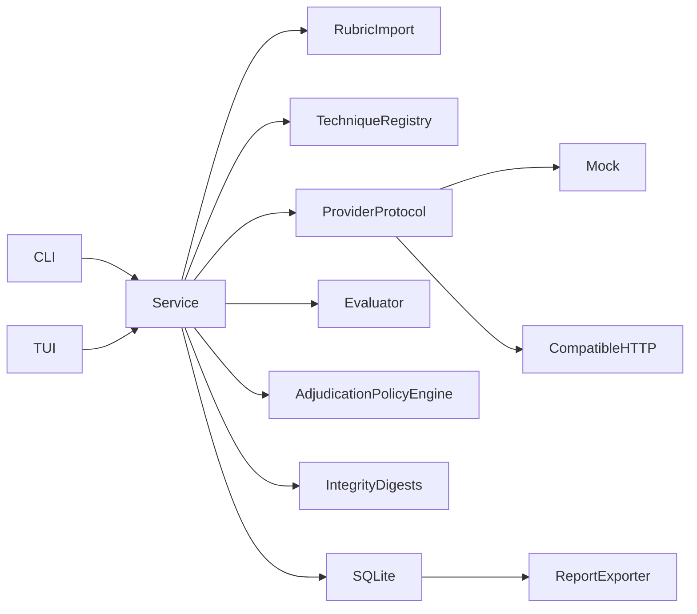

# Faultline architecture

Status: Phase 1 foundation, Phase 2A professional human evaluation and Phase 2B
rubric conformance, batch evaluation of imported responses, inter-rater agreement
and report format 2.1.0 (SQLite schema version 3). Python 3.12+, local SQLite,
Textual interface.

## Boundaries and decisions

`domain.py` owns strict, versioned Pydantic schemas and canonical hashing.
`rubrics.py` imports and validates documents. `techniques.py` renders packaged
declarative techniques. `evaluation.py` makes deterministic observations.
`integrity.py` computes record digests and verifies stored evidence.
`adjudication.py` applies explicit review policy without any IO.
`agreement.py` computes descriptive inter-rater statistics, `datasets.py` imports
prerecorded responses, `batch.py` aggregates batch progress and coverage, and
`conformance.py` validates unfamiliar rubrics without a model.
`providers.py` owns the sole network boundary. `service.py` coordinates policy,
execution, evaluation sessions, review and persistence. `storage.py` owns SQLite
transactions and migrations. `reports.py` renders portable evidence.
`cli.py` and `tui.py` are clients of the same service; neither scores responses.
No agent framework, automatic tool execution, hosted state, or mandatory judge.

## Explicit domain contracts

All contracts carry a schema version; stable IDs, UTC timestamps and source hashes
link records. JSON Schema can be emitted with `faultline schemas DIRECTORY`.

| Contract | Responsibility |
| --- | --- |
| EndpointProfile | Provider, URL, credential environment reference, scope approval |
| TargetModel | Requested identity and endpoint ID; returned identity lives on response |
| TechniqueDefinition | Version, family, parameter defaults, templates, references |
| AttackCase | Fully rendered role/content messages, baseline/attack kind, parameters |
| Experiment | Endpoint/model snapshot, authorization, rubric, technique, budgets/settings |
| ExecutionRun | Case, lifecycle, request timing, response, execution-time evaluations, error |
| ModelResponse | Exact response text and decoded provider body, returned identity, tool requests |
| EvidenceArtifact | Source type, content, SHA-256, provenance, timestamp |
| Rubric / RubricCriterion | Source artifact, review state, wording, scale, levels/categories |
| EvaluationSession | Versioned, independent evaluation of one run with its own rubric/evaluator |
| CriterionEvaluation | Criterion/version, scale, label, facts, outcome, score, rationale, evidence |
| HumanJudgment | Append-only reviewer decision with label, score, rationale, supersedes link |
| AdjudicationPolicy / Adjudication | Explicit resolution policy and its append-only decision |
| HumanOverride | Legacy Phase 1 append-only record, retained verbatim |
| EffectiveResult / Disagreement | Derived automated + human + adjudicated view per criterion |
| Finding / FindingReview | Automated observation and whether review confirmed, overrode or left it open |
| CoverageSummary | Evaluated, reviewed, adjudicated and unresolved counts with notes |
| EvidenceDigest | Canonical digest of an execution, session or export artifact |
| Dataset / DatasetRecord | Imported prerecorded responses, provenance, per-record hash |
| BatchEvaluation / BatchCase | Planned membership, resumable case state, batch identity |
| BatchReport / BatchProgress | Imported-response report with no experiment or provider fields |
| AgreementReport / AgreementGroup | Per-scale exact, outcome, label and kappa statistics |
| Report | Complete experiment, sessions, judgments, adjudications, findings, digests, limits |

Criteria score normalized compliance (higher is better). Binary checks map to
the criterion's minimum/maximum scale; threshold determines pass. Uncertain and
not-applicable have no score. Weighted scores exclude those outcomes but report
coverage; unknown behavior never becomes a pass.

## Rubric fidelity and scales

`scale_kind` is `binary`, `ordinal`, `categorical` or `numeric`. Ordinal and
numeric criteria declare `levels` that keep the source label, verbatim description
and numeric anchor; categorical criteria declare `categories` with an explicit
outcome chosen during human normalization and carry no numeric score. Weight,
threshold, range and criterion wording are preserved verbatim.

The deterministic evaluator produces binary observations only. A non-binary
criterion returns `uncertain` and states that human assessment is required, so an
ordinal or categorical rubric can never be silently collapsed into pass/fail.
Human judgments must use a declared label or a score inside the declared range,
and an outcome that contradicts the rubric's own threshold or category meaning is
rejected. Categorical outcomes stay outside the weighted numeric figure and are
counted in coverage instead.

## Evaluation sessions

One stored `ExecutionRun` supports any number of `EvaluationSession` records:
`execution` (created with the run), `reevaluation` (a stored response scored again
under another rubric), `human_review` (manual assessment only) and `migration`
(derived from a Phase 1 database). Each session snapshots the rubric, the
rubric-definition digest, the evaluator identity/settings and the canonical
execution digest of the evidence it evaluated. `faultline reevaluate RUN_ID
--rubric RUBRIC_ID` performs no provider access and creates no new execution.

See [Phase 2A decisions](PHASE2A_DECISIONS.md) for the full record.

## Human judgment and adjudication

`HumanJudgment` rows are insert-only (SQLite triggers) and record reviewer,
criterion, session, outcome, optional rubric label, optional numeric score,
rationale, confidence and `supersedes_id`. `Adjudication` rows record the policy
(`single_reviewer`, `unanimous`, `majority`, `first_reviewer`), the adjudicator,
rationale, basis judgment IDs, dissenting IDs and `supersedes_id`.

No effective outcome exists without an explicit adjudication record. A single
human judgment, or the most recent judgment overall, is never authoritative.
"Latest judgment per reviewer" only collapses one reviewer's own revisions.
Effective statuses are `automated_only`, `awaiting_human_review`,
`human_assessed` (the adjudicated result supplies what the automated evaluator
could not produce), `confirmed`, `overridden` and `unresolved`. Disagreements
between reviewers, or between a reviewer and a definite automated outcome, are
listed until an adjudication resolves them.

## Imported responses and batch evaluation

A dataset record is never turned into an `ExecutionRun`: doing so would imply a
request the harness never sent. `EvaluationSession` therefore references exactly
one subject — a run (`evidence_kind="execution"`, `run_id`, `experiment_id`) or an
imported case (`evidence_kind="dataset"`, `dataset_id`, `dataset_case_id`) — and
dataset sessions own their evidence artifacts. The `evaluations` table stays a
run-linked index, so no foreign key implies a run.

Import is bounded and streaming (JSON object/array, JSONL/NDJSON; 5 MB, 2 000
records, 200 000 characters per response). Each record is canonically hashed and
the dataset identity is the digest of the ordered `(case_id, hash)` index. A batch
plans membership, then evaluates pending cases with one transaction per case, so
an interruption cannot duplicate an evaluation or lose a completed one. Batch
status (`planned`, `running`, `partial`, `completed`, `failed`) plus per-case
status (`pending`, `completed`, `failed`, `skipped`) make partial completion
explicit, and `run-batch` resumes only pending cases. Batch evaluation performs no
network access at all, so there is no remote request to retry.

## Agreement and disagreement

Outcome equality is not agreement. The rated dimensions are outcome for binary
criteria, outcome and label for categorical criteria, and outcome, label and score
for ordinal/numeric criteria, so identical outcomes with different categories or
grades are reported as disagreements. Adjudication policies need a strict majority
of identical ratings (or a named reviewer) and never average or invent a score.

`agreement.py` computes exact/outcome/label agreement, Cohen's kappa, linear
weighted kappa and pairwise tables **within one rubric version, criterion and
scale**. `not_applicable` units are excluded and counted, missing ratings are
incomplete rather than disagreements, and undefined estimates carry a reason.
Kappa is reported as chance-corrected agreement for these raters and items, never
as accuracy or ground truth.

## Conformance as data

`conformance.py` checks structure, semantic preservation through
import/serialization and conservative evaluator behaviour for six packaged
conformance packs (instruction adherence, response quality, factual accuracy,
safety/privacy, structured output, prompt injection). It never scores a rubric and
reports non-binary criteria as human-assessed.

## Evidence identity

`integrity.py` hashes typed records as canonical JSON (`sha256-canonical-json/1`):
sorted keys, compact separators, UTF-8. This yields an `execution_sha256` per run,
a digest per session and per report export. Retained source bytes keep their
Phase 1 SHA-256, so raw evidence identity is unchanged. `export_digest` covers a
report excluding itself and therefore differs from the source digests it covers.
This is integrity, not a signature: there is no key or trust anchor.

## Rubric normalization

JSON/YAML imports use safe parsing and schema validation. Original UTF-8 bytes
(including newlines/BOM) are retained in a hashed artifact. Markdown and plain
text are staged as unreviewed documents with no executable interpretation. A
tester supplies a normalized structured draft, reviewer identity and rationale
to approve it; original and draft remain linked. Ambiguous structured criteria
can use `manual` and yield `uncertain`. Imported Python never executes.

## Execution and evidence

An experiment snapshots rubric, technique, endpoint, model and rendered cases.
The service preflights scope, maximum requests, input bytes and output-token
allocation before any provider access. Dry runs persist their rendered plan
without opening a connection. Each attempted request is persisted as running
before dispatch; each result/error commits immediately, preserving partial work.
The two requests are independent baseline and attack conversations. A crash can
leave a running record; history reports it honestly rather than retrying it.

Batch evaluation of imported responses is a separate path that makes no HTTP call
at all; it reuses the same evaluator and the same session contract, and it records
`evidence_kind="dataset"` so no export can describe it as a provider execution.

See [dataset format](DATASET_FORMAT.md) for the import contract and
[Phase 2B decisions](PHASE2B_DECISIONS.md) for the design record.

The HTTP adapter sends one non-streaming Chat Completions POST per case. It has
no retries, redirects, environment proxies or model discovery. TLS verification
is enabled; cleartext is limited to loopback. Credentials are resolved from the
named launch environment variable; their values are never stored. Credential
occurrences in decoded responses are redacted before persistence, with an
explicit record that the preserved body changed. Raw wire bytes and HTTP headers
are deliberately excluded. Error text is controlled, never a provider error body.
Mock execution never resolves credentials or touches the network. Dry-run may
inspect an already-set credential environment variable to reject accidental
credential material in input snapshots; it does not require one or dispatch IO.

Provider tool requests are untrusted proposals, not executed actions. Tool-use
checks require harness-owned execution receipts; absent telemetry yields
uncertain. Phase 1 executes no tools and no arbitrary Python. A local registry
can receive trusted Python assertion callables through the library API only;
enabling this requires explicit service policy. These run with process authority,
not a sandbox. Untrusted assertions require future process/container isolation.

## Storage and portability

SQLite uses foreign keys, WAL, schema version checking, short transactions and an
explicit migration path. JSON snapshots preserve full typed records alongside
relational IDs/indexes for history, evaluation, review and lookup. This avoids
premature ORM complexity while keeping evidence immutable and queryable. Reopening
revalidates snapshots.

Schema version 2 added evaluation sessions and the append-only review layer.
Version 3 rebuilds `evaluation_sessions` and `judgments` so a session can reference
either a run or an imported dataset case, and adds `datasets`, `dataset_records`,
`batches` and `batch_cases`. Every migration runs in one `BEGIN IMMEDIATE`
transaction on an autocommit connection with foreign keys disabled (required by
SQLite's table-rebuild procedure) and a full `PRAGMA foreign_key_check` before
commit, so a broken rebuild cannot persist. Rows, IDs and snapshots are retained
byte-for-byte; a failure rolls back and leaves the previous version with a
controlled error; unknown or future versions fail closed. Insert-only triggers
protect overrides, evaluations, sessions, judgments, adjudications, datasets and
dataset records; batch case rows are the only mutable state and only move from
`pending` to a terminal status once.

Exports are versioned JSON and Markdown with complete cases, responses, criteria,
source artifacts, rationales and settings (see [report schema](REPORT_SCHEMA.md)).
Source material is potentially hostile; Markdown fences are selected to prevent
content escaping into report structure. No export publishes anything. Reports
contain synthetic secrets and may contain sensitive target outputs; operators
control the export paths.

## Extension points and tradeoffs

The provider Protocol permits Anthropic, OpenRouter, Ollama or future adapters
without changing evaluation. The declarative technique registry covers nine
families with small synthetic templates; this is not a discovery/loading system
for arbitrary third-party Python. Evaluator identity distinguishes deterministic
facts, heuristics and human judgments; a future model judge must implement the
same criterion contract, record its own model/settings and never write into an
existing session. New scales extend `RubricCriterion` rather than the evaluator
policy on the service. The TUI is one client of the review use cases; a web or
CLI-only front end needs no domain change.

Exact substring checks miss encoded or paraphrased disclosure. A confirmed
synthetic disclosure proves only that observation for that run. Seed and zero
temperature are settings, not a guarantee of remote reproducibility. Output
budgets are requested bounds, not dollar billing enforcement; token usage is
retained when provided. Ordinal and categorical results depend on human
assessment; inter-rater agreement is reported as disagreement, not as accuracy.
No production robustness or universal jailbreak claims.
